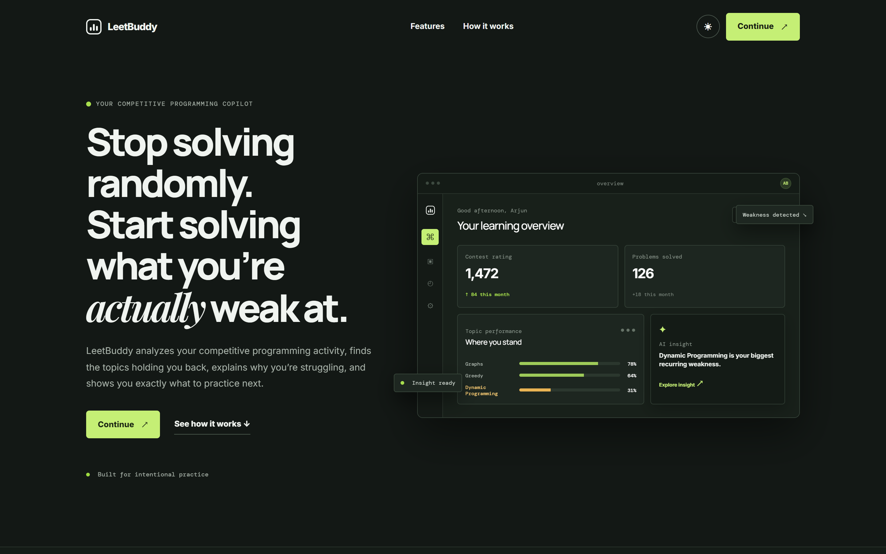
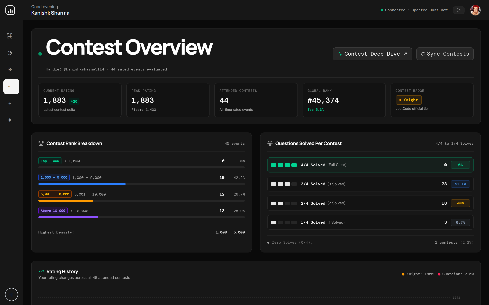
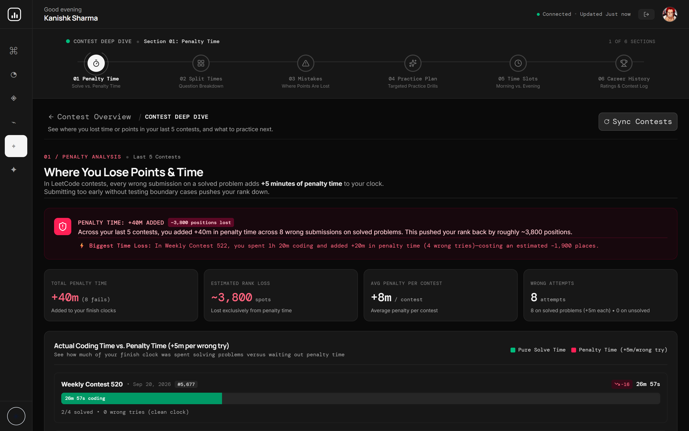
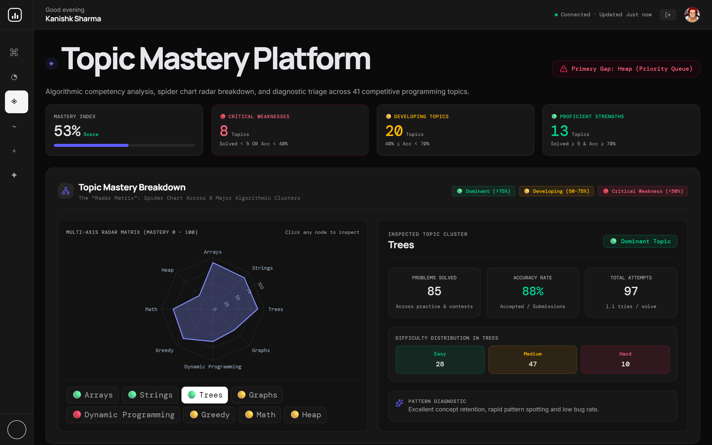
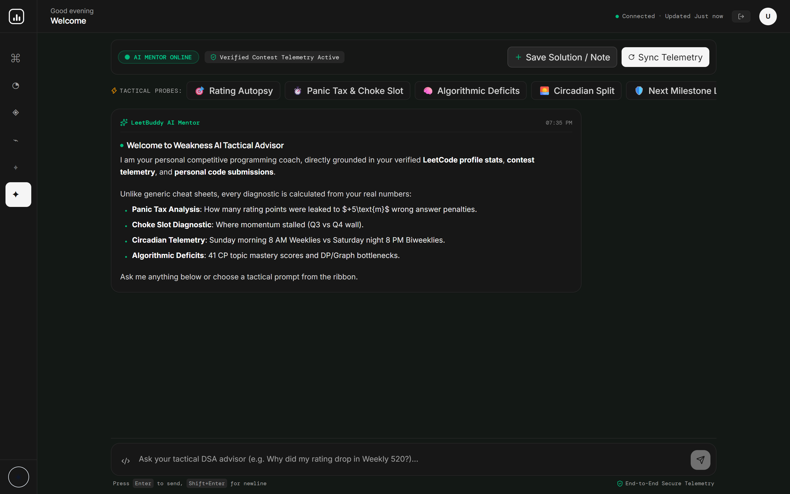

<div align="center">

# ⚡ LeetBuddy
### *Stop solving randomly. Start solving what you’re actually weak at.*

**An engineering-grade competitive programming analytics platform and RAG-powered AI coaching copilot that diagnoses your contest bottlenecks, calculates your penalty overhead, and prescribes targeted practice ladders.**

<br />

[](https://leet-buddy-six.vercel.app/)
[](https://leetbuddy-fr3s.onrender.com/api/health)
[](LICENSE)

<br />

[](https://react.dev/)
[](https://tailwindcss.com/)
[](https://nodejs.org/)
[](https://expressjs.com/)
[](https://www.mongodb.com/)
[](https://ai.google.dev/)
[](https://www.pinecone.io/)
[](https://www.langchain.com/)

<br />

<p align="center">
  
</p>

</div>

---

## 🎯 The Problem

Most competitive programmers practice in an inefficient, blind loop:
> *Pick random problem ➔ Get stuck ➔ Read editorial ➔ Forget pattern ➔ Contest rating stays flat.*

Standard platforms display your aggregate rating number and simple solve counts, but never answer the critical questions:
- **Why did your rating drop in last Sunday's contest?** Was it algorithmic gap, syntax fumble, or time crunch?
- **How many leaderboard ranks did you lose from unforced penalties?**
- **Which specific topic (e.g. DP state transitions, Graph DAG cycles) is your genuine bottleneck?**
- **What exact sequence of 3–4 problems should you practice today to fix it?**

**LeetBuddy** connects to your public LeetCode profile, ingests your historical contest submission telemetry, and provides actionable, data-backed diagnostics paired with a personalized AI coach that knows your real performance history.

---

## 🌟 Visual Tour & Core Features

### 1. 📈 Contest Performance & Rating Mountain
Track your true rating trajectory, global percentile tier (Knight / Guardian), and competitive solve consistency over time.

<p align="center">
  
</p>

- **Rating Mountain Trajectory:** Interactive visualization of your contest progression with peak tracking (e.g. 1883 peak rating) and contest milestone markers.
- **Global Rank Density:** Understand where you stand relative to the top percentiles of competitive programmers worldwide.
- **Solve Efficiency Matrix:** Instant overview of total contests attended, median finish time, and historical solve rates across Q1 through Q4.

---

### 2. ⏱️ 90-Minute Autopsy & "Panic Tax" Analysis
In timed contests, speed matters — but rushed submissions cost heavily. LeetBuddy audits every individual contest with surgical precision.

<p align="center">
  
</p>

- **6-Step Interactive Autopsy:** Step through each problem of any contest to inspect your finish timestamp, attempt timeline, and penalty overhead.
- **The "Panic Tax" Calculator:** Every wrong submission adds a mandatory +5 minute penalty. LeetBuddy computes your cumulative penalty time across contests (e.g., +40m penalty time) to reveal how many leaderboard ranks were lost to hasty, unverified code.
- **Circadian Performance Split:** Compares Saturday evening Biweekly contests vs. Sunday morning Weekly contests to isolate focus and fatigue factors.

---

### 3. ◈ 41-Topic Mastery & Competency Radar
Stop guessing which DSA concepts need attention. LeetBuddy classifies your competency across 41 competitive programming topics.

<p align="center">
  
</p>

- **Spider Radar Matrix:** Multi-dimensional visualization across foundational algorithms, tree structures, dynamic programming, and graph theory.
- **Automatic Triage:**
  - 🟢 **Proficient Strengths ($\ge 70\%$):** High solve rate under time pressure.
  - 🟡 **Developing Areas ($40\% - 69\%$):** Inconsistent accuracy; needs ladder practice.
  - 🔴 **Weak Gaps ($< 40\%$):** Critical choke points that directly suppress contest rating.
- **Category Deep Dive:** One-click drill down into problem volume, difficulty splits, and targeted next steps for any topic.

---

### 4. 🧠 Grounded Weakness AI Copilot
A competitive programming coach that knows your verified strengths, contest mistakes, and historical submission timeline.

<p align="center">
  
</p>

- **Zero-Hallucination RAG Pipeline:** Powered by Google Gemini 2.5 Flash, Pinecone vector embeddings (768-dim), and LangChain. The assistant retrieves your actual contest data before responding.
- **Tactical Quick-Probes:** Instant one-click diagnostics:
  - *“Why did my rating drop in my last contest?”*
  - *“What should I practice to break through 1900 rating?”*
  - *“Build me a 3-week study roadmap targeting Dynamic Programming.”*
- **Socratic Guidance:** Provides conceptual nudges, edge case hints, and optimal complexity requirements rather than spoiling full editorial solutions.

---

### 5. 🔒 Zero-Password Verification Handshake
Connect your LeetCode account without ever exposing your credentials, password, or session cookies:
1. Enter your LeetCode handle.
2. Receive a unique, ephemeral 12-character verification token.
3. Paste the token into your public LeetCode *About Me* bio.
4. Click **Verify** — LeetBuddy validates ownership via the public GraphQL profile and activates your account.

---

## 🛠️ System Architecture & Tech Stack

```
                                  ┌────────────────────────┐
                                  │   User Web Browser     │
                                  └───────────┬────────────┘
                                              │
                                              ▼
                                 [ Vercel Edge Network ]
                              React 19 + Vite + Tailwind v4
                                              │
                         ┌────────────────────┴────────────────────┐
                         │ /api/* (First-party Reverse Proxy)      │
                         ▼                                         │
               [ Render Web Service ]                              │
               Node.js + Express 5 API                             │
                         │                                         │
        ┌────────────────┼────────────────┬────────────────┐       │
        ▼                ▼                ▼                ▼       ▼
 ┌──────────────┐ ┌──────────────┐ ┌──────────────┐ ┌────────────────────┐
 │   MongoDB    │ │   Pinecone   │ │ Google Gemini│ │  LeetCode GraphQL  │
 │    Atlas     │ │  Vector DB   │ │  2.5 Flash   │ │   Public API       │
 │ (Telemetry & │ │ (RAG Memory  │ │  (AI Coach   │ │  (Contests, Stats, │
 │  User Cache) │ │  Embeddings) │ │   Dialogue)  │ │   Bio Validation)  │
 └──────────────┘ └──────────────┘ └──────────────┘ └────────────────────┘
```

| Layer | Technologies | Purpose |
| :--- | :--- | :--- |
| **Frontend** | React 19, Vite, Tailwind CSS v4, Lucide Icons, Recharts, Framer Motion | Modern, zero-lag responsive user interface with dark glassmorphism |
| **Backend** | Node.js (v20+), Express 5, Morgan, Cookie-Parser, CORS | High-throughput REST API with rate-limiting and custom middleware |
| **AI / RAG** | Google Gemini 2.5 Flash, LangChain, Pinecone Vector DB | Context-grounded retrieval engine with 768-dimensional embeddings |
| **Database** | MongoDB Atlas, Mongoose ODM | Sub-50ms indexed queries for contest logs, topics, and profiles |
| **Security** | Dual JWT (Access + HTTP-only Refresh) + SHA-256 session rotation | Cross-domain hardened authentication with strict CSRF protection |
| **Reliability**| Vercel Edge Proxy + Render Web Service + 14-min Heartbeat | Zero cross-origin cookie rejection and continuous warm-instance uptime |

---

## 🚀 Getting Started (Local Development)

### Prerequisites
- **Node.js** (v18.0.0 or higher)
- **npm** or **pnpm**
- **MongoDB URI** (local instance or free [MongoDB Atlas](https://www.mongodb.com/atlas) cluster)
- **Google Gemini API Key** ([Google AI Studio](https://aistudio.google.com/))
- **Pinecone API Key & Index** ([Pinecone Console](https://www.pinecone.io/))

---

### 1. Clone the Repository
```bash
git clone https://github.com/kanishk3114S/LeetBuddy.git
cd LeetBuddy
```

### 2. Configure & Run Backend
```bash
cd Backend
npm install
```

Create a `.env` file in `Backend/`:
```env
PORT=3000
MONGODB_URI=your_mongodb_connection_string
JWT_SECRET=your_jwt_secret_key
GEMINI_API_KEY=your_gemini_api_key
PINECONE_API_KEY=your_pinecone_api_key
PINECONE_INDEX_NAME=leetbuddy-memory
FRONTEND_URL=http://localhost:5173
```

Start the API server:
```bash
npm run dev
```
*API will run at `http://localhost:3000`. Verify with `curl http://localhost:3000/api/health`.*

### 3. Configure & Run Frontend
In a separate terminal:
```bash
cd Frontend/frontend
npm install
npm run dev
```
*Frontend will launch at `http://localhost:5173`.*

---

## 🌐 Production Deployment Architecture

- **Frontend:** Hosted on [Vercel](https://vercel.com/) with native edge caching and instant invalidation.
- **Backend:** Hosted on [Render](https://render.com/) running Node.js in an isolated Linux container.
- **Reverse Proxy Routing:** `vercel.json` proxies all `/api/*` traffic transparently to Render, eliminating third-party cookie restrictions across Safari ITP, iOS WebKit, and Brave Shields.
- **Warm Standby Uptime:** Automated 14-minute HTTP heartbeat checks keep the server active and eliminate cold starts.

---

## 👤 Author

**Kanishk Sharma**
- 🌐 **Portfolio / Live Demo:** [leet-buddy-six.vercel.app](https://leet-buddy-six.vercel.app/)
- 💻 **LeetCode:** [@KanishkSharma3114](https://leetcode.com/KanishkSharma3114) *(Knight Badge, 1883 Peak Rating)*
- 💼 **LinkedIn:** [kanishk-sharma-b0912735a](https://www.linkedin.com/in/kanishk-sharma-b0912735a/)
- 🐙 **GitHub:** [@kanishk3114S](https://github.com/kanishk3114S)

---

## 📄 License

This project is licensed under the [MIT License](LICENSE).
<br />
<div align="center">
  <sub>Built with intention for competitive programmers who want to stop grinding blindly and start competing with clarity.</sub>
</div>
